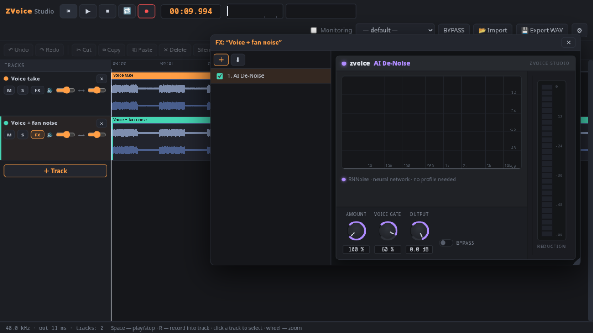
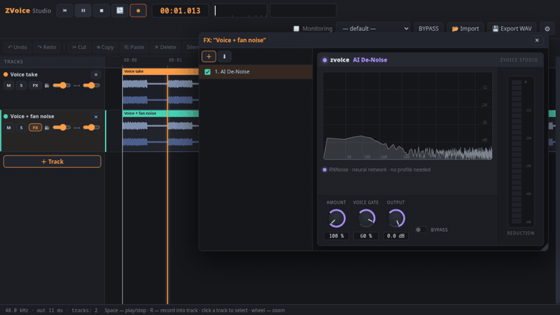

# ZVoice Studio

**Record clean voice in seconds.** A free multitrack voice recorder with an
**AI noise remover** and real-time FX chains — Reaper-style workflow,
FabFilter-style panels. No installation, no account, no cloud, no telemetry.
Runs fully offline.




**Watch the noise disappear:**



## Why ZVoice

| | ZVoice Studio | Audacity | Online tools (Adobe Podcast…) |
|---|---|---|---|
| Setup | **unpack & run** (~0 s) | installer | sign-in, upload to cloud |
| AI noise removal | **✓ one knob, no profile** | ✗ | ✓ but your audio leaves the machine |
| Real-time FX while recording | **✓ hear the chain live** | ✗ (post only) | ✓ |
| Reaper-style items & punch-in | **✓** | ✗ | ✗ |
| Multitrack with per-track chains | **✓** | ✓ | ✗ |
| Works offline / private | **✓ 100 %** | ✓ | ✗ |

**Perfect for:** voice-over dailies · podcast punch-ins · recording voice
datasets for AI training · cleaning up an old fan-y recording · ASMR and
dictation · anyone who just wants a working recorder *with* processing.

## Features

- **AI De-Noise (RNNoise neural network, compiled to WebAssembly)** — removes
  fans, hum, air-conditioners and street noise with a single knob. No noise
  profile, no "learn" step. Plus an energy-based voice gate that silences
  the gaps between phrases
- **12 real-time plugins** with live displays (spectrum, waveform, LED meters):
  AI De-Noise · De-Noiser · Gate · De-Esser · EQ (6 bands + response curve) ·
  Compressor · Limiter · Saturation · Chorus · Delay · Reverb · Gain —
  a separate FX chain for every track, audible while you record
- **Multitrack timeline with items** (Reaper-style): every recording or import is a
  separate clip — drag it, move it between tracks, split it at the cursor, glue everything back
- **Punch-in recording**: select a region → ⏺ → re-record just that piece; older takes are trimmed, not deleted
- **Waveform editor**: selection, cut/copy/paste, silence, fades, normalize, undo/redo
- **Export**: mix of all tracks or a solo track as WAV 16/24-bit, plus a dry mix without processing
- **Projects**: save/load `.zvproj` — a plain ZIP with a WAV per item plus all chain settings
- **Customization**: interface language (English/Русский), themes, accent color, UI scale,
  track height, output device, output volume, fully remappable hotkeys

## Built with

| Layer | Technology |
|---|---|
| Application logic | **Vanilla JavaScript** (ES modules) — no frameworks, no build step |
| Real-time DSP | **Web Audio API + AudioWorklet** (gate, de-esser and de-noiser are custom worklets with own FFT) |
| AI denoiser | **RNNoise** (Xiph.Org, BSD) cross-compiled to **WebAssembly** with clang — runs inside an AudioWorklet |
| Visualization | **Canvas 2D** — waveform timeline, plugin displays, LED meters, spectrum |
| UI | **HTML/CSS** — dark DAW theme, custom rotary knobs |
| Web version server | **Python 3** standard library only (static no-cache server) |
| Desktop shell | **Electron** — own window, microphone access without permission dialogs |
| Project files | **ZIP written from scratch** (STORE method) + 24-bit **WAV** encoder — `project.json` + one WAV per item |
| Persistence | **IndexedDB + File System Access API** — remembers your project folder |

## Built with AI assistance

ZVoice Studio was created by **Dalucard87** together with an AI coding agent
(ZCode, powered by GLM) in a human-directed workflow: the human set the product
vision, made every design and feature decision, tested each build and owns the
releases — the AI wrote and refactored the code under that direction.
All third-party components (RNNoise, Electron, etc.) are properly licensed and
credited below.

## Download

Ready-to-run bundles are published on the
[**Releases page**](https://github.com/Dalucard87/zvoice-studio/releases/latest) —
Electron runtime and the app are already packed inside, just unpack and launch:

| File | OS | Run |
|---|---|---|
| `ZVoice-Studio-<version>-linux-x64.zip` | Linux 64-bit | `chmod +x launch.sh && ./launch.sh` |
| `ZVoice-Studio-<version>-win64.zip` | Windows 64-bit | double-click `launch.bat` |
| `ZVoice-Studio-<version>-macos-arm64.zip` | macOS Apple Silicon | `chmod +x launch.sh && ./launch.sh` |
| `ZVoice-Studio-<version>-macos-x64.zip` | macOS Intel | `chmod +x launch.sh && ./launch.sh` |

No installation required. **macOS note:** the app is unsigned, so macOS may block
the first launch — run `xattr -cr ZVoice-Studio` from the unpacked folder once
(or right-click → Open).

## Quick start

### Web version — all platforms (Python 3 + any Chromium-based browser)

| OS | Command |
|---|---|
| Linux / macOS | `./run.sh` |
| Windows | double-click `run.bat` |

Then open <http://localhost:8765>. Grant microphone access when asked.

### Desktop version — own application window (Electron)

| OS | One-time setup | Run |
|---|---|---|
| Linux / macOS | `./desktop/setup-desktop.sh` | `./desktop/launch.sh` |
| Windows | `desktop\setup-desktop.bat` | `desktop\launch.bat` |

The setup script downloads Electron (~120 MB) once. Desktop shell adds:
a proper app window, microphone without permission dialogs, `.desktop` menu entry (Linux, see below).

### Linux — add to the applications menu

```bash
./install-desktop-entry.sh
```

Installs a `ZVoice Studio` launcher (works on GNOME, KDE, XFCE and any XDG-compliant desktop).

## Default hotkeys

| Action | Key |
|---|---|
| Play / Stop | `Space` |
| Record (into selected track) | `R` |
| Loop selection | `L` |
| Undo / Redo | `Ctrl+Z` / `Ctrl+Shift+Z` |
| Cut / Copy / Paste | `Ctrl+X` / `C` / `V` |
| Select all / Clear selection | `Ctrl+A` / `Esc` |
| Delete selection | `Del` |
| Cursor to start | `Home` |

Every hotkey can be remapped or disabled in ⚙ → Hotkeys.

## Recording workflow (Reaper-style)

1. `＋ Track` → press `R` → the take lands on the track as an **item** at the cursor
2. Record again → the next item is placed right after, nothing is overwritten
3. Messed up a word? Select it → `R` → punch-in replaces just that region
4. Grab an item by its name bar to move it (even to another track)
5. `Split` cuts an item at the cursor; `Glue` mixes all tracks into one
6. Apply FX per track in the FX window; export the mix as WAV

## FAQ

**Is my audio uploaded anywhere?** No. Everything runs locally — the AI
denoiser included (the neural network runs in WebAssembly inside your app).

**Why does the AI De-Noise meter show nothing on loud clean speech?** It only
shows *reduction* — on clean speech the network passes the signal through.

**Browser or desktop?** Same app. Desktop adds a native window, microphone
without permission dialogs and an applications-menu entry.

## Project format

`.zvproj` is a standard ZIP you can open with any archiver:

```
project.json      — track list: names, volume, pan, mute/solo, full FX chains, item positions
track-01-*.wav    — raw 24-bit PCM per item — pull any sound out with any tool
```

Audio lives in memory while the app runs — save the project or export WAV before closing.

## Architecture

```
index.html            — markup
server.py / run.*     — optional no-cache static server for the web version
js/main.js            — app: tracks, items, recording, projects, hotkeys, settings
js/engine/            — mixer (FX chain per track), clip ops + undo, recorder,
                        WAV codec, ZIP container, offline render
js/plugins/           — 12 plugins (FabFilter-style panels) + displays (spectrum/waveform/history)
js/ui/                — item timeline, FX window, knobs, meters, settings dialog
worklets/             — AudioWorklet DSP: gate, de-esser, de-noiser, AI denoiser + rnnoise.wasm
desktop/              — Electron shell (window + permission-free microphone)
```

## Credits

[RNNoise](https://github.com/xiph/rnnoise) by Jean-Marc Valin / Xiph.Org Foundation
(BSD-3-Clause), cross-compiled to WebAssembly for this project — see
`worklets/rnnoise-LICENSE`.

## License

Copyright (C) 2026 **Dalucard87** — [GNU GPL v3](LICENSE).
All application code is written from scratch.
Electron is distributed under its own MIT license.
